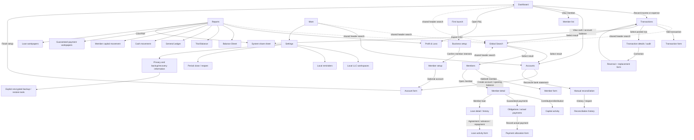

# Proposed Navigation Map

This is a recommendation, not the current navigation implementation. Current native navigation is a horizontal set of eight tabs: Dashboard, Search, Transactions, Accounts, Members, Loans, Reports, Settings. The redesign mockups propose five bottom tabs; this map consolidates those concepts without changing source behavior.

## Placement recommendations

| Capability | Proposed home | Reason / guardrail |
|---|---|---|
| Accounts | More → Accounts, with account balance summaries and account access from Dashboard | It is an infrequent setup/maintenance destination but must remain one tap from the dashboard balance. The current full account/reconciliation panel can be separated into account list and focused reconciliation state. |
| Reconciliation | More → Accounts → Reconcile; also expose “Reconcile” from an account row | Related to bank account context, not a separate permanent bottom tab. No bank feed or credentials. |
| Guaranteed payments | Members → Member detail → Payments/obligations | A payment obligation and actual payment belong to a member. Show obligations and cash events separately; direct dashboard shortcut may open the actual payment form. |
| Member loans | Members → Member detail → Loans | Debt is associated with a lender/member and must remain distinct from capital. Loans are not a top-level frequent transaction tab. A global loan summary may be linked from Reports. |
| Settings | More → Settings | Keep privacy statement, local workspace selection, reminders, period close/reopen, and backup/recovery discoverable in one utility area. |
| Search | Labeled global search action in the shared header on each tab; transaction-specific filters remain in Transactions | Keep the existing cross-record search capability without a permanent sixth tab. Selecting a result opens its relevant section. This is a recommendation pending usability confirmation. |
| Export | Reports → specific report → CSV/PDF; Transactions → CSV | Use the platform share sheet and state that sharing may copy data outside the device. Never email or schedule exports automatically. |

## High-frequency task paths

1. **Record an expense:** Dashboard “Record expense” → transaction form with Expense selected → amount, date, cash account, category, description → review/post → return to Transactions or Dashboard. Do not require a member assignment.
2. **Add a capital contribution:** Dashboard/member summary → Members → member → Add capital activity → contribution kind/date/account/amount/description → confirm/post. Cash contribution changes cash and member capital, not income. Property contribution requires a valuation/CPA-review note and must not silently create an unsupported tax value.
3. **Record a member payment:** Members → member → Guaranteed payments → select actual obligation(s) and allocation → cash account/date/amount → confirm/post. An obligation alone changes neither cash nor cash-basis expense. Do not classify the payment as capital.
4. **Export reports:** Reports → choose report and date/as-of range → inspect visible totals/basis → CSV or PDF → native share sheet. Do not show “tax ready,” “file,” or email/scheduled upload actions.

## Current vs proposed navigation friction

- Current horizontal navigation has eight items and may scroll on phone width; Search, Accounts, Loans, and Settings have equal visual weight with Dashboard and Transactions.
- Mockups standardize a five-tab bottom bar but leave Accounts/Reconciliation and loans placement implicit. The map makes those paths explicit while keeping member debt/payment context attached to a member.
- Current member, transaction, and report components combine many workflows in long scrolling screens. A focused second-level view can reduce density, but avoid deep stacks: common actions should be reachable in one to three transitions.
- Do not implement five tabs until interaction prototypes confirm Search remains discoverable, More is understood, and Android back behavior remains predictable.
